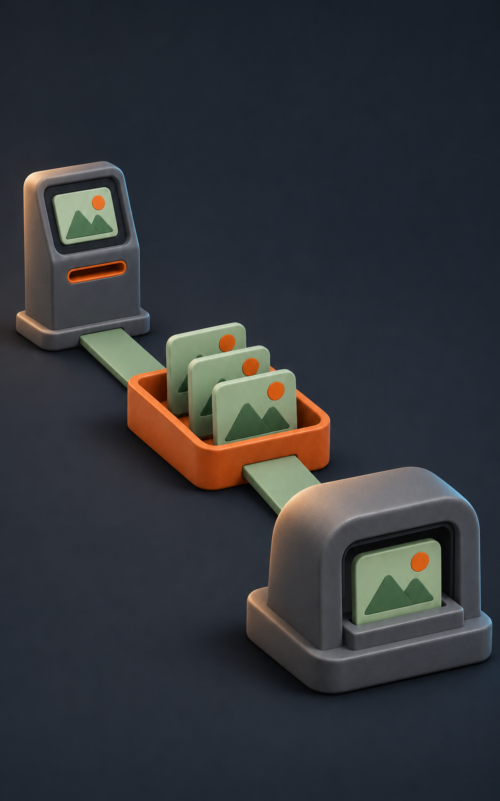
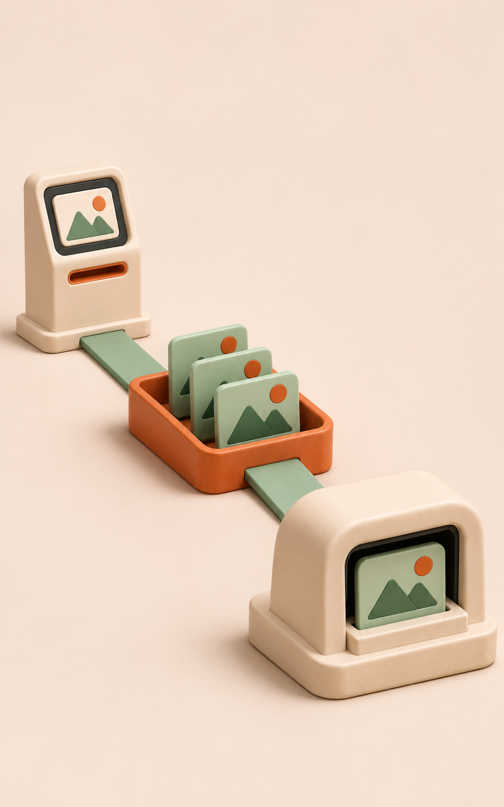
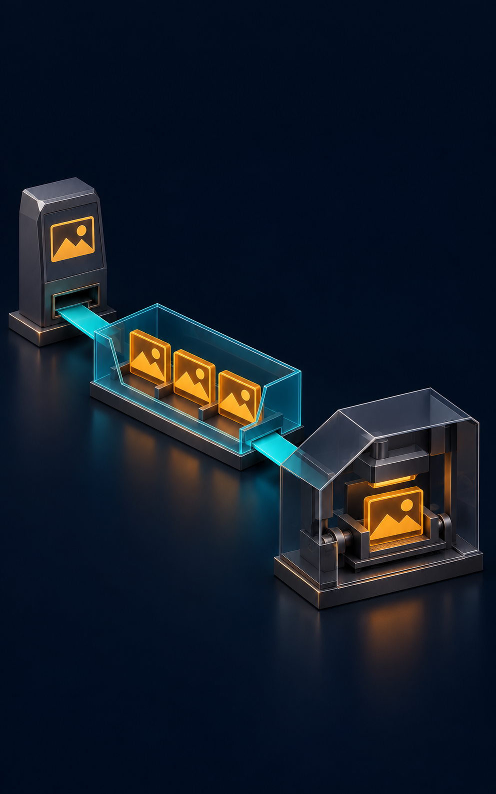
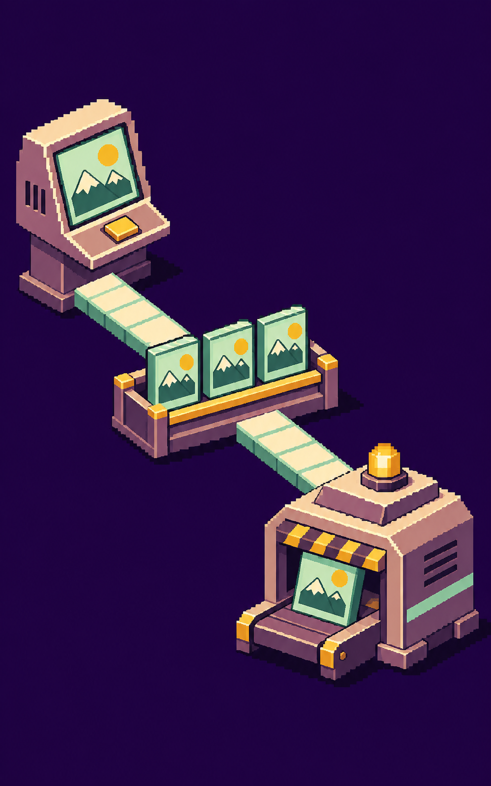
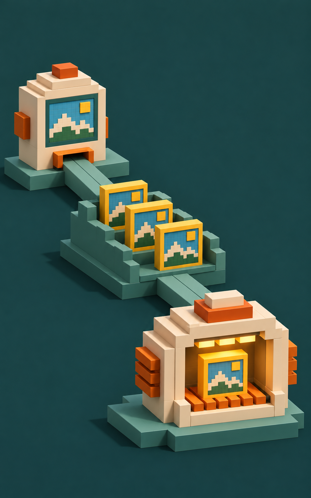
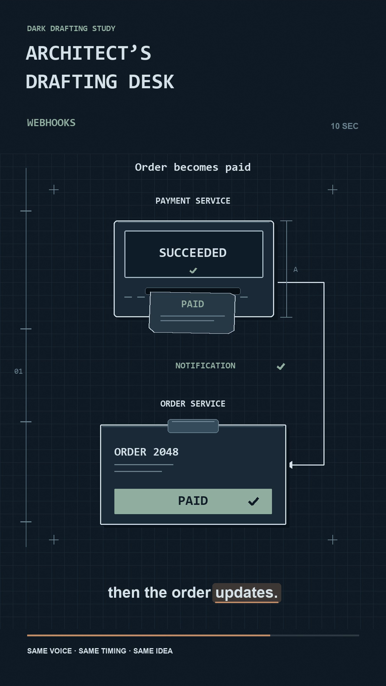

# Visual style picker

For a new episode without a chosen style, show the saved samples below and ask
one question: "Which style should this video use?" Keep the labels and names
beside their images so the user can answer by letter or name. You may recommend
one with a short teaching reason, but wait for the user's answer before visual
production. A default option, elapsed time or silence is not a choice.
Continue source research and style-independent script planning while waiting.

An explicit style in the request, a recorded choice for this episode, or an
explicit request to choose on the user's behalf satisfies the choice. Do not ask
again on continuation. General preferences and earlier episodes do not select
the style for a new episode. If the user delegates the decision, state the
selected treatment and show its saved sample.

## Show the images when asking

Resolve these files relative to the installed skill, inspect the actual pixels,
and display the previews in the user-visible conversation immediately before
the question. Use image attachments or inline image output that the host
supports. Agent-only image inspection, style names, filenames and download links
alone do not satisfy the visual choice. If a question tool accepts only text,
show the images first, then use the same labels in its question or choices.

Reuse the saved images rather than regenerating them for each invocation. Keep
their aspect ratios and make each sample large enough to compare materials and
composition. If the host cannot display them, explain that limitation and keep
the choice pending until the user can view the samples or explicitly delegates
the decision. Do not silently choose the historical default.

Record the displayed sample paths/hashes, the user's answer and the selected
variant in the production document. Keep style selection separate from video
acceptance. These stills do not establish animation, narration or causal accuracy.

## A. Sculpted studio, dark

Slate ceramic, charcoal background, seafoam and terracotta accents.

## B. Sculpted studio, light

Warm ivory ceramic, soft shadows, seafoam and terracotta accents.

## C. Glass cutaway

Dark transparent housings with visible internal parts and amber records.

## D. Pixel circuit

Retro sprites and stepped contours on a deep purple field.

## E. Voxel workshop

Block-built forms, grounded shadows and warm illuminated machinery.

## F. Dark drafting desk

Dark slate, precise ivory lines, copper and sage accents.

## Other styles and references

[Neon Chalk Systems](neon-chalk-systems.md) remains available. Before offering it
or another style as an additional visual choice, obtain and show an actual
reference for that treatment. This gallery has no separate Neon Chalk still;
do not relabel another sample as one. A supplied user reference can also define
the episode's style.

Use [3D and pixel-art styles](style-options.md) or
[Dark drafting desk](dark-drafting-desk.md) for the selected treatment's directions.
The [sample manifest](../assets/style-references/style-options-manifest.json)
preserves the generated samples' prompts, dimensions and hashes. The drafting-desk
reference has its own provenance in its style guide. Keep the source images in
the skill package so future invocations can show the same references.
